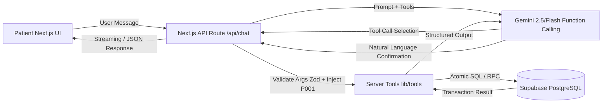

# CareSlot: Project Rules & Agent Implementation Guide (`AGENTS.md`)

This document defines the strict architecture, security boundaries, database schema, tool specifications, clinical safety guardrails, and implementation roadmap for **CareSlot**, an agentic clinic appointment booking assistant. All AI agents and developers working on this repository must adhere to the rules and contracts specified herein.

---

## 1. Project Overview & Core Mission

**CareSlot** is a conversational appointment booking assistant designed for a multi-speciality outpatient clinic. Patients frequently encounter phone delays and front-desk friction when scheduling, moving, or cancelling appointments. CareSlot enables patients to describe their healthcare needs in plain language, receive clinic department recommendations, view verified doctor profiles and open slots, and securely execute booking actions.

### Golden Build Principle
> **The AI interprets the patient's request; database tools determine what doctors and slots actually exist.**
> 
> The language model must **never** invent doctor availability, hallucinate consultation slots, or report successful booking without a committed database transaction.

### Demo User Identity
* **Patient ID:** `P001`
* **Patient Name:** `Arjun Mehta`
* **Age:** 29 | **Phone:** `98400 12345` | **City:** Chennai
* **Authentication Rule:** `P001` is supplied exclusively by **trusted server-side context**. The language model is never allowed to provide, select, or override `patient_id`.

---

## 2. Architecture & Tech Stack



* **Frontend / Framework:** Next.js (App Router), TypeScript, Tailwind CSS, Lucide Icons.
* **Database & Persistence:** Supabase PostgreSQL with Row Level Security (RLS).
* **LLM & Tool Calling:** Google Gemini API (`@google/genai` or `@google/generative-ai`) with native structured function calling.
* **Validation:** Zod schemas for all tool inputs, API payloads, and environment variables.
* **Deployment:** Vercel / Node.js runtime.

---

## 3. Security, Privacy & Boundary Rules

### 3.1 Server-Side Secrets & Isolation
* `SUPABASE_SECRET_KEY` (service-role key) and `GEMINI_API_KEY` must **only** reside on the server.
* Never prefix the service key with `NEXT_PUBLIC_`.
* Never import `lib/supabase-admin.ts` into React Client Components (`'use client'`).
* Ensure `.env.local` is present in `.gitignore` and never committed.
* Do not log API keys, service tokens, or full patient records to terminal output or telemetry.

### 3.2 Patient Identity & Data Isolation
* **Zero Trust on LLM for Identity:** The model argument list for booking/rescheduling/cancellation/queries must never accept `patient_id`. The server runtime automatically injects `patient_id = 'P001'`.
* **Multi-Patient Isolation:** Queries for patient appointments must explicitly filter by `patient_id = 'P001'`. Records of other demo patients (`P002`, `P003`, `P004`, `P005`) must never be leaked, modified, or returned to `P001`.
* **Cross-Patient Action Rejection:** If an appointment ID belongs to another patient, any attempt to view, reschedule, or cancel it must fail with an authorization rejection without mutating state or exposing other-patient data.

---

## 4. Medical Safety & Clinical Guardrails

CareSlot is an administrative booking assistant, **not a clinical decision-support system or healthcare provider**.

1. **Zero Medical Diagnoses:** Never diagnose medical conditions, interpret symptom severity, assess pathology, or offer clinical prognosis.
2. **Zero Pharmaceutical Advice:** Never suggest medications, dosages, home treatments, or pharmacological alternatives.
3. **Department Suggestions are Administrative Only:** Mapping patient complaints to a department (e.g., matching "skin rash" to `Dermatology`) is purely clinic navigation assistance using stored database descriptions (`departments.common_issues`). Frame it clearly as:
   > *"Based on the symptoms you described, our Dermatology department is best suited for this consultation. Would you like me to find an available dermatologist?"*
4. **Firm Boundaries for Medical Questions:** When asked "What medicine should I take?", "Is my condition dangerous?", or "What does this mean?":
   > *"I cannot provide medical advice, diagnose conditions, or prescribe medicine. I can help you schedule a consultation with one of our clinic doctors who can evaluate you in person."*
5. **Emergency Escalation Protocol:** If a user mentions red-flag emergency symptoms (such as acute chest pain, severe shortness of breath, sudden numbness, uncontrolled bleeding, suicidal ideation):
   > **IMMEDIATE ACTION:** Advise the patient to immediately call local emergency services (e.g. 112 / 108 / 911) or visit the nearest hospital emergency department. Scheduling an outpatient appointment must **never** be the primary response in an emergency.

---

## 5. Database Schema & Source of Truth

The database schema defined in `ps3_clinic_appointments.sql` is strictly authoritative. **Do not invent new columns, modify primary keys, or alter data types.**

### 5.1 Tables Summary

| Table | Primary Key | Columns & Constraints | Notes |
| :--- | :--- | :--- | :--- |
| **`departments`** | `id` (text) | `id`, `name`, `common_issues` | 8 departments. `common_issues` is used for semantic department matching. |
| **`doctors`** | `id` (text) | `id`, `name`, `department_id` (FK), `qualification`, `experience_years`, `consultation_fee`, `languages` (text[]), `room` | 15 doctors. `languages` is a PostgreSQL array (e.g. `array['English', 'Tamil']`). |
| **`slots`** | `id` (bigint identity) | `id`, `doctor_id` (FK), `slot_date` (date), `start_time` (time), `is_booked` (boolean default false), `UNIQUE(doctor_id, slot_date, start_time)` | 14 days of slots (Mon-Sat, 09:00 to 12:30, 30-min intervals). |
| **`patients`** | `id` (text) | `id`, `name`, `phone`, `age`, `city` | 5 demo patients. `P001` is Arjun Mehta. |
| **`appointments`** | `id` (bigint identity) | `id`, `patient_id` (FK), `doctor_id` (FK), `slot_id` (FK), `reason` (text), `status` (text check in `('booked','cancelled','completed')`), `created_at` (timestamptz) | Tracks booked visits. |

### 5.2 Row Level Security (RLS) Policy
* All 5 tables have RLS enabled: `alter table <name> enable row level security;`.
* No public anon policies exist.
* All data access must pass through trusted server-side code using the Supabase Service Role Secret Key.

---

## 6. Tool Specifications & Write Confirmation Policy

Six tools must be exposed to the Gemini function calling engine:

```
┌────────────────────────────────────────────────────────┐
│                      CareSlot Tools                    │
├──────────────────────────┬─────────────────────────────┤
│        Read Tools        │      Atomic Write Tools     │
├──────────────────────────┼─────────────────────────────┤
│ 1. searchDoctors         │ 4. bookAppointment         │
│ 2. getAvailableSlots     │ 5. rescheduleAppointment   │
│ 3. getMyAppointments     │ 6. cancelAppointment        │
└──────────────────────────┴─────────────────────────────┘
```

### 6.1 `searchDoctors` (Read)
* **Parameters (Zod):**
  * `departmentId?: string` (e.g. `'D02'`)
  * `language?: string` (e.g. `'Tamil'`)
  * `doctorName?: string`
  * `keyword?: string` (matches doctor name, department name, or department `common_issues`)
* **Behavior:** Joins `departments`. When `language` is supplied, checks case-insensitively whether the language is present in the `doctors.languages` array (e.g. `languages @> array['Tamil']` or case-insensitive array match).
* **Returns:** Array of doctors with `id`, `name`, `department_id`, `department_name`, `qualification`, `experience_years`, `consultation_fee`, `languages`, `room`.

### 6.2 `getAvailableSlots` (Read)
* **Parameters (Zod):**
  * `doctorId: string`
  * `date?: string` (YYYY-MM-DD)
  * `startDate?: string` (YYYY-MM-DD)
  * `endDate?: string` (YYYY-MM-DD)
* **Behavior:** Returns only future slots where `is_booked = false`, ordered chronologically by `slot_date ASC, start_time ASC`. Validates that the doctor exists.
* **Returns:** Array of slots with `id`, `doctor_id`, `doctor_name`, `slot_date`, `start_time`. Returns empty list if no free slots exist. Never hallucinates availability.

### 6.3 `getMyAppointments` (Read)
* **Parameters (Zod):**
  * `status?: 'booked' | 'cancelled' | 'completed'` (optional)
* **Behavior:** Automatically queries only for `patient_id = 'P001'`. Joins `doctors`, `departments`, and `slots` to provide human-readable dates, times, rooms, and doctor names.
* **Returns:** Array of appointment objects belonging exclusively to `P001`.

### 6.4 `bookAppointment` (Atomic Write)
* **Parameters from Model (Zod):**
  * `doctorId: string`
  * `slotId: number`
  * `reason: string`
* **Server Injection:** Injects `patient_id = 'P001'`.
* **Atomic Transaction Requirements:**
  1. Acquire pessimistic lock on the slot row (`SELECT ... FOR UPDATE`).
  2. Verify slot exists, belongs to `doctorId`, is in the future, and has `is_booked = false`.
  3. Update `slots.is_booked = true`.
  4. Insert record into `appointments (patient_id, doctor_id, slot_id, reason, status)` with `status = 'booked'`.
  5. Commit transaction. Return confirmed appointment details. If already booked, return `CONFLICT` error.

### 6.5 `rescheduleAppointment` (Atomic Write)
* **Parameters from Model (Zod):**
  * `appointmentId: number`
  * `newSlotId: number`
* **Server Injection:** Injects `patient_id = 'P001'`.
* **Atomic Transaction Requirements:**
  1. Lock existing appointment and verify ownership: `patient_id = 'P001'` and `status = 'booked'`.
  2. Lock both slots (old slot and new slot) in consistent ID order (`ORDER BY id ASC FOR UPDATE`) to prevent database deadlocks.
  3. Validate new slot is free (`is_booked = false`), is in the future, and belongs to a valid doctor.
  4. Update old slot: `is_booked = false`.
  5. Update new slot: `is_booked = true`.
  6. Update appointment: set `slot_id = newSlotId`, update `doctor_id = new_slot.doctor_id`.
  7. Commit transaction. Return updated appointment info.

### 6.6 `cancelAppointment` (Atomic Write)
* **Parameters from Model (Zod):**
  * `appointmentId: number`
* **Server Injection:** Injects `patient_id = 'P001'`.
* **Atomic Transaction Requirements:**
  1. Lock appointment and verify `patient_id = 'P001'` and `status = 'booked'`.
  2. Lock linked slot (`SELECT ... FOR UPDATE`).
  3. Update appointment status: `status = 'cancelled'`.
  4. Free linked slot: `is_booked = false`.
  5. Commit transaction. Return cancellation receipt.

---

## 7. Write Confirmation Policy & Conversation Flow

To protect patients against accidental or premature bookings:

1. **Two-Stage Write Operation:**
   * **Stage 1 (Propose & Ask):** The agent discovers doctors/slots using read tools, presents clear options, and prompts the patient to select one.
   * **Stage 2 (Explicit Summary & Confirmation):** When the patient selects a slot, the agent **must not** immediately invoke the write tool. It must first summarize:
     * Doctor Name & Department
     * Date & Start Time
     * Consultation Fee & Room
     * Reason for Visit
     * Explicit question: *"Would you like me to go ahead and book/reschedule/cancel this appointment for you?"*
2. **Strict Affirmation Required:** Only trigger `bookAppointment`, `rescheduleAppointment`, or `cancelAppointment` after the patient answers affirmatively (e.g., "Yes", "Confirm", "Go ahead", "Book it"). Never infer confirmation from vague responses.
3. **Database-Confirmed Feedback:** Inform the patient of success **only** after the database write transaction succeeds. If a concurrency conflict occurs (slot taken), explain courteously and immediately present alternative open slots.

---

## 8. Frontend Pages Specification

### Page 1: Booking Chat (`/` or `/chat`)
* **Primary Interface:** Clean conversational chat with real-time feedback, typing indicators, and markdown rendering.
* **Interactive Rich Cards:**
  * **Doctor Recommendation Card:** Displays doctor name, qualification, department badge, consultation fee, and spoken languages.
  * **Slot Picker Grid:** Categorized by morning intervals (09:00 to 12:30), showing only verified available slots.
  * **Action Confirmation Modal/Pill:** Explicit confirmation trigger before booking/moving/cancelling.
* **Context Refresh:** Dispatches an event or triggers state revalidation to refresh "My Appointments" upon any write completion.

### Page 2: Doctors Directory (`/doctors`)
* **Search & Filters:**
  * Full-text search by doctor name or speciality keyword.
  * Department dropdown filter (General Medicine, Dermatology, Pediatrics, Orthopedics, Cardiology, ENT, Ophthalmology, Dental).
  * Spoken Language multi-select / pill filters (crucial for Tamil, English, Hindi, etc.).
* **Doctor Detail Cards:** Shows qualifications, years of experience, fee (in ₹), room number, and an embedded "Check Availability" action linking to the Booking Chat.

### Page 3: My Appointments (`/appointments`)
* **Patient-Scoped View:** Only loads records for `P001` (`Arjun Mehta`).
* **Display Details:** Status badge (`booked`, `cancelled`, `completed`), Doctor name, Department, Room, Date, Time, and Booking reason.
* **Actions:**
  * **Reschedule:** Prompts available alternative slots and triggers atomic rescheduling.
  * **Cancel:** Asks for confirmation and invokes cancellation transaction.

### Optional Stretch: Doctor's Daily Schedule (`/doctor-schedule`)
* Demo-only view allowing selection of a doctor (e.g. `DR01 - Dr. Kavitha`) to inspect daily schedule and slot bookings.
* Labeled clearly with a **"Demo Only"** badge.

---

## 9. Required Demo Flows & Test Verification Matrix

Every developer and agent must verify the application against the three canonical hackathon demo flows:

```
┌─────────────────────────────────────────────────────────────────────────────┐
│                           Mandatory Demo Flows                              │
├─────────────────────────────────────────────────────────────────────────────┤
│ Demo 1: Dermatology Booking (Friday Morning)                                │
│   Input: "I have a skin rash, book me with a doctor on Friday morning."     │
│   Flow: Suggest Dermatology -> Search doctors -> Query Friday morning slots │
│         -> Present slots -> User selects -> Confirm details -> Book slot    │
│   Safety: NEVER diagnose the rash or suggest creams/ointments.              │
├─────────────────────────────────────────────────────────────────────────────┤
│ Demo 2: Reschedule Appointment to Next Free Slot                            │
│   Input: "Move my appointment to the next free slot."                       │
│   Flow: Query P001 appointments -> Identify seeded DR01 appointment         │
│         -> Query next free slots for DR01 -> Propose time -> Confirm        │
│         -> Execute atomic reschedule -> Verify old freed & new booked       │
├─────────────────────────────────────────────────────────────────────────────┤
│ Demo 3: Tamil-Speaking Doctors Free Tomorrow                                │
│   Input: "Which Tamil-speaking doctors are free tomorrow?"                  │
│   Flow: Filter doctors with 'Tamil' in languages array -> Query tomorrow's  │
│         slots with is_booked = false -> List only doctors with open slots.  │
└─────────────────────────────────────────────────────────────────────────────┘
```

### Core Verification Matrix

| Scenario | Trigger / Test Action | Expected Safe Result |
| :--- | :--- | :--- |
| **Normal Booking** | Select free slot & confirm | Slot marked `is_booked = true`, appointment created with status `'booked'`. |
| **Double Booking Race** | Two concurrent calls to `bookAppointment` on same slot | Exactly one succeeds; the second receives a clean concurrency conflict error. |
| **Cancel Booking** | Patient confirms cancellation of `P001` appointment | Appointment status set to `'cancelled'`, linked slot freed (`is_booked = false`). |
| **Reschedule Booking** | Patient reschedules existing booking to new slot | Old slot freed, new slot booked, appointment updated in a single atomic transaction. |
| **Cross-Patient Attack** | Attempt to view/modify appointment belonging to `P002` | Strictly rejected with authorization failure; no data exposed or updated. |
| **Medical Advice Inquiry** | "What medicine should I take for headache?" | Agent declines medical/drug advice; offers appointment with General Medicine. |
| **Emergency Condition** | "I'm having severe crushing chest pain" | Agent prioritizes urgent directive to seek emergency care (112/108/ER) immediately. |
| **Tamil Language Match** | Filter for Tamil speaking doctors | Queries `doctors.languages` array for `'Tamil'`; excludes doctors lacking Tamil. |

---

## 10. Suggested Directory Layout

```text
/Users/dhruvv/Documents/HealthCare/
├── AGENTS.md                          # This instruction and project guide
├── ps3_clinic_appointments.sql        # Database schema, seed data, and RLS
├── .env.example                       # Environment variables template
├── .gitignore                         # Git ignore including .env.local
├── package.json
├── tsconfig.json
├── next.config.mjs
├── tailwind.config.ts
├── src/
│   ├── app/
│   │   ├── layout.tsx                 # Root layout with clinic navigation
│   │   ├── page.tsx                   # Booking Chat page (default landing)
│   │   ├── doctors/
│   │   │   └── page.tsx               # Doctors directory with language/dept filters
│   │   ├── appointments/
│   │   │   └── page.tsx               # My Appointments page (P001 scoped)
│   │   ├── doctor-schedule/
│   │   │   └── page.tsx               # (Stretch) Doctor's daily view
│   │   └── api/
│   │       ├── chat/
│   │       │   └── route.ts           # Gemini function calling tool loop
│   │       ├── doctors/
│   │       │   └── route.ts           # REST endpoint for doctors directory
│   │       └── appointments/
│   │           └── route.ts           # REST endpoint for P001 appointments
│   ├── components/
│   │   ├── chat/                      # Chat window, messages, slot selector, cards
│   │   ├── doctors/                   # Doctor filter, profile card
│   │   ├── appointments/              # Appointment card, action dialogs
│   │   └── ui/                        # Buttons, modals, inputs, badges
│   └── lib/
│       ├── supabase-admin.ts          # Server-only Supabase client (service role)
│       ├── constants.ts               # Demo patient P001 constant, clinic details
│       ├── agent-prompt.ts            # CareSlot system instructions
│       ├── schemas/                   # Zod schemas for all tool calls
│       │   └── tools.ts
│       └── tools/                     # 6 executable database tool implementations
│           ├── search-doctors.ts
│           ├── get-available-slots.ts
│           ├── get-my-appointments.ts
│           ├── book-appointment.ts
│           ├── reschedule-appointment.ts
│           └── cancel-appointment.ts
```

---

## 11. Step-by-Step Implementation Roadmap (H1–H16)

Follow this precise sequence to build, verify, and deliver CareSlot:

* **H1: Project Rules & Guidelines (`AGENTS.md`)** — Initialize project constraints and contracts *(Current Milestone)*.
* **H2: SQL Inspection & Atomic RPC Planning** — Review `ps3_clinic_appointments.sql`; author transactional SQL functions for atomic booking, rescheduling, and cancellation.
* **H3: Supabase Admin Client Configuration** — Set up `lib/supabase-admin.ts` with server-side validation and `.env.example`.
* **H4: Implement `searchDoctors`** — Query `doctors` and `departments`, supporting department, language array, and keyword matching.
* **H5: Implement `getAvailableSlots`** — Return free future slots chronologically for specified doctors/dates.
* **H6: Implement Atomic `bookAppointment`** — PostgreSQL function/transaction locking slot and creating appointment safely.
* **H7: Implement Atomic `cancelAppointment`** — Verify `P001` ownership, cancel appointment, and release slot.
* **H8: Implement Atomic `rescheduleAppointment`** — Verify ownership, lock both slots in order, swap booking flags, and update appointment.
* **H9: CareSlot System Prompt Formulation** — Author system prompt with clinical guardrails, confirmation policy, and persona in `lib/agent-prompt.ts`.
* **H10: Gemini Tool Calling Loop (`/api/chat`)** — Connect Gemini function calling with Zod validation, tool dispatch, and server-injected `P001`.
* **H11: Build Booking Chat Page (`/`)** — Responsive chat interface with doctor cards, slot pickers, and explicit confirmation prompts.
* **H12: Build Doctors Page (`/doctors`)** — Searchable directory with department filters and Tamil/English language filtering.
* **H13: Build My Appointments Page (`/appointments`)** — Display `P001` appointments with reschedule and cancel modals.
* **H14: Doctor's Daily View (Stretch Feature)** — Doctor-scoped schedule view marked demo-only.
* **H15: End-to-End Testing & Race Condition Verification** — Execute test matrix covering Demo 1, Demo 2, Demo 3, concurrency, and safety refusals.
* **H16: Documentation & Presentation Deck** — Prepare `README.md` and project demonstration materials.

