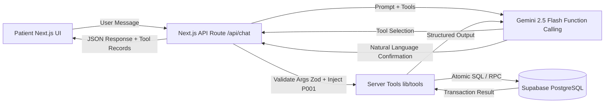

# CareSlot — Conversational Clinic Appointment Booking Assistant

> **SRM Agentic AI Hackathon · Problem Statement 3**  
> An autonomous, database-grounded booking assistant for a multi-speciality outpatient clinic. Patients describe symptoms in plain words; CareSlot matches clinic departments, finds verified doctors and open slots, and safely books, reschedules, or cancels appointments.

---

## 1. The Front-Desk Problem

Patients calling outpatient clinics face long phone queues, front-desk friction, and manual scheduling delays. CareSlot solves this by providing:
- **Plain-language interaction:** Patients explain what hurts or what they need without needing medical terminology.
- **Administrative department matching:** Maps complaints to clinic specialties using stored clinic data (`departments.common_issues`).
- **Database truthfulness:** Availability is strictly determined by real database queries — never invented by the language model.
- **Zero double-booking:** Atomic PostgreSQL transactions guarantee slot isolation even during concurrent requests.
- **Strict clinical safety boundaries:** Refuses to diagnose conditions or recommend medications; escalates emergencies immediately.

---

## 2. Architecture & Tech Stack



- **Frontend:** Next.js (App Router, Turbopack), TypeScript, Tailwind CSS, Lucide Icons.
- **Backend / API:** Next.js Route Handlers with `server-only` isolation.
- **Database:** Supabase PostgreSQL with Row Level Security (RLS) enabled on all tables.
- **LLM Engine:** Google Gemini API (`@google/genai`) with native structured function calling.
- **Validation:** Zod schemas for all tool inputs, payloads, and queries.

---

## 3. Demo Identity & Security Invariants

### 3.1 Demo User Context
- **Patient ID:** `P001`
- **Patient Name:** `Arjun Mehta`
- **Age:** 29 | **Phone:** `98400 12345` | **City:** Chennai

### 3.2 Security Boundaries
- **Zero Trust on LLM for Identity:** The model argument list for booking/rescheduling/cancellation/queries **never** accepts `patient_id`. The server runtime automatically injects `patient_id = 'P001'`.
- **Server-Only Secrets:** `SUPABASE_SERVICE_ROLE_KEY` and `GEMINI_API_KEY` reside exclusively on the server. `lib/supabase-admin.ts` enforces `import "server-only"` to block any client bundle inclusion.
- **Multi-Patient Isolation:** Queries for patient appointments strictly filter by `patient_id = 'P001'`. Records of other demo patients (`P002`–`P005`) are never leaked, modified, or returned.
- **Cross-Patient Action Rejection:** Any attempt to reschedule or cancel another patient's appointment fails at the database level with a `FORBIDDEN` error.

---

## 4. Medical Safety & Clinical Guardrails

CareSlot is an administrative booking assistant, **not a clinical decision-support system**.

1. **Zero Medical Diagnoses:** Never diagnose conditions, evaluate symptom severity, or assess pathology.
2. **Zero Pharmaceutical Advice:** Never suggest medications, dosages, ointments, or home treatments.
3. **Administrative Routing Only:** Mapping complaints (e.g. "skin rash" → Dermatology) is purely clinic navigation assistance using database descriptions (`departments.common_issues`).
4. **Firm Boundaries:** If asked "What medicine should I take?", the assistant declines and offers to book a consultation with a qualified doctor.
5. **Emergency Escalation Protocol:** If acute red-flag symptoms are mentioned (crushing chest pain, severe shortness of breath, sudden numbness, uncontrolled bleeding), the assistant immediately directs the patient to call emergency services (**112 / 108 / nearest ER**). Booking an outpatient visit is prohibited as an emergency response.

---

## 5. Database Schema (Authoritative: `ps3_clinic_appointments.sql`)

| Table | Primary Key | Key Columns | Purpose |
|:---|:---|:---|:---|
| **`departments`** | `id` (text) | `id`, `name`, `common_issues` | 8 specialties. `common_issues` used for semantic routing. |
| **`doctors`** | `id` (text) | `id`, `name`, `department_id`, `qualification`, `experience_years`, `consultation_fee`, `languages`, `room` | 15 specialists. `languages` is PostgreSQL `text[]`. |
| **`slots`** | `id` (bigint) | `id`, `doctor_id`, `slot_date`, `start_time`, `is_booked`, `UNIQUE(doctor_id, slot_date, start_time)` | 14 rolling days, Mon–Sat, 09:00–12:30 (8 slots/day/doctor). |
| **`patients`** | `id` (text) | `id`, `name`, `phone`, `age`, `city` | 5 demo patients. `P001` is Arjun Mehta. |
| **`appointments`** | `id` (bigint) | `id`, `patient_id`, `doctor_id`, `slot_id`, `reason`, `status`, `created_at` | Status constrained to `('booked', 'cancelled', 'completed')`. |

---

## 6. Six Exposed Tools & Safe Atomic Writes

```
┌────────────────────────────────────────────────────────┐
│                      CareSlot Tools                    │
├──────────────────────────┬─────────────────────────────┤
│        Read Tools        │      Atomic Write Tools     │
├──────────────────────────┼─────────────────────────────┤
│ 1. searchDoctors         │ 4. bookAppointment         │
│ 2. getAvailableSlots     │ 5. rescheduleAppointment   │
│ 3. getMyAppointments     │ 6. cancelAppointment        │
└──────────────────────────┴─────────────────────────────┘
```

### 6.1 Concurrency & Anti-Double Booking Logic
- **`bookAppointment(doctorId, slotId, reason)`**: Acquires `SELECT ... FOR UPDATE` on the slot row. Verifies `is_booked = false` and doctor match. Sets `is_booked = true` and inserts the appointment atomically in PostgreSQL (`book_appointment.sql`). Concurrent race attempts result in a clean `CONFLICT` error.
- **`rescheduleAppointment(appointmentId, newSlotId)`**: Locks appointment and validates `P001` ownership. Locks old and new slots in **consistent ascending ID order** (`min_id`, `max_id`) to prevent deadlocks. Atomically frees old slot, reserves new slot, and updates appointment in one transaction (`reschedule_appointment.sql`).
- **`cancelAppointment(appointmentId)`**: Locks appointment, verifies `P001` ownership and `status = 'booked'`, marks status as `'cancelled'`, and resets linked slot `is_booked = false` (`cancel_appointment.sql`).
- **Two-Stage Write Confirmation:** Before any write, CareSlot summarizes the exact Doctor, Department, Date, Start Time, Fee, Room, and Reason, requiring explicit patient affirmation ("Yes, confirm") before triggering the write tool.

---

## 7. Pages Overview

1. **Booking Chat (`/`)**: Real-time conversational interface with typing indicators, interactive Doctor Recommendation Cards, Chronological Slot Picker Grids, Action Confirmation Pills, and live-synced My Appointments sidebar.
2. **Doctors Directory (`/doctors`)**: Searchable specialist directory with department filters and language filters (Tamil fluency check). Includes an availability inspector modal.
3. **My Appointments (`/appointments`)**: Scoped exclusively to `P001` (Arjun Mehta). Shows upcoming, completed, and cancelled visits with direct **Reschedule** and **Cancel** action dialogs.
4. **Doctor's Schedule View (`/doctor-schedule`)**: Optional stretch feature labeled **Demo Only**. Allows inspecting daily outpatient timelines strictly filtered to the chosen clinician and date.

---

## 8. Canonical Hackathon Demo Flows

### Demo 1 — Dermatology Booking (Friday Morning)
- **User:** *"I have a skin rash, book me with a doctor on Friday morning."*
- **CareSlot:** Suggests Dermatology from clinic data (`departments.common_issues`), queries dermatologists, presents Friday morning free slots, prompts selection, summarizes details, asks for explicit confirmation, and commits the booking atomically.

### Demo 2 — Reschedule Seeded Appointment to Next Free Slot
- **User:** *"Move my appointment to the next free slot."*
- **CareSlot:** Calls `getMyAppointments`, identifies Arjun's seeded visit with `DR01` (Dr. Kavitha), checks Dr. Kavitha's next free slots, proposes the earliest slot, requests confirmation, and executes atomic rescheduling (releasing old slot, reserving new slot).

### Demo 3 — Tamil-Speaking Doctors Free Tomorrow
- **User:** *"Which Tamil-speaking doctors are free tomorrow?"*
- **CareSlot:** Filters doctors where `languages @> array['Tamil']` (11 of 15 doctors), queries tomorrow's open slots (`is_booked = false`), and returns only doctors with open appointments.

---

## 9. Setup & Local Installation

### Prerequisites
- Node.js 18+ (tested on Node.js 24)
- A development Supabase project
- A Google Gemini API key

### Steps

1. **Clone the repository:**
   ```bash
   git clone https://github.com/Dhruvv-16/CareSlot.git
   cd CareSlot
   ```

2. **Install dependencies:**
   ```bash
   npm install
   ```

3. **Database Setup (Dev Project Only):**
   - Open your Supabase Dashboard → **SQL Editor**.
   - Paste and run [`ps3_clinic_appointments.sql`](./ps3_clinic_appointments.sql) (creates 5 tables, seed data, and RLS).
   - Paste and run the 3 transactional RPC functions:
     - [`src/lib/sql/book_appointment.sql`](./src/lib/sql/book_appointment.sql)
     - [`src/lib/sql/reschedule_appointment.sql`](./src/lib/sql/reschedule_appointment.sql)
     - [`src/lib/sql/cancel_appointment.sql`](./src/lib/sql/cancel_appointment.sql)

4. **Configure Environment Variables:**
   ```bash
   cp .env.example .env.local
   ```
   Edit `.env.local` with your credentials:
   ```env
   SUPABASE_URL=https://<your-project-ref>.supabase.co
   SUPABASE_SERVICE_ROLE_KEY=eyJ...your-service-role-secret-key...
   GEMINI_API_KEY=AIza...your-gemini-api-key...
   GEMINI_MODEL=gemini-2.5-flash
   ```

5. **Run the Automated Test Suite (101 Tests):**
   ```bash
   npm test
   ```

6. **Start Development Server:**
   ```bash
   npm run dev
   ```
   Open [http://localhost:3000](http://localhost:3000) in your browser.

---

## 10. Test Matrix Verification

CareSlot includes a complete test suite covering all 10 hackathon matrix scenarios:
```bash
npm test
```

```
═════════════════════════════════════════════════════════════════
 CareSlot End-to-End Acceptance Test Matrix (H15)
═════════════════════════════════════════════════════════════════
✅ SCENARIO 1: Skin-rash request suggests Dermatology without diagnosis
✅ SCENARIO 2: Find Tamil-speaking doctors free tomorrow
✅ SCENARIO 3: Show only future free slots (no past or booked slots)
✅ SCENARIO 4: Book a slot atomically with server-injected P001
✅ SCENARIO 5: Book same slot again and verify conflict (race protection)
✅ SCENARIO 6: Cancel and verify slot freed atomically
✅ SCENARIO 7: Reschedule P001 seeded appointment and verify swap
✅ SCENARIO 8: Reject another patient's appointment ID (cross-patient attack)
✅ SCENARIO 9: My Appointments only shows P001 records
✅ SCENARIO 10: Refuse diagnosis/medicine advice & emergency escalation
─────────────────────────────────────────────────────────────────
Result: 10 passed, 0 failed (101/101 total unit & matrix tests passed)
```

---

## License & Credits
Built for the **SRM Agentic AI Hackathon 2026**. All patient names and medical clinic records are synthetic test fixtures.
